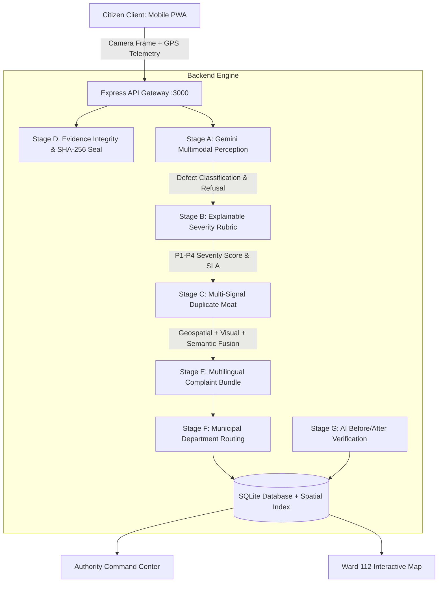

# Reality Scanner 📸🚨
> *"See a problem. Point. It's reported."*
> Mobile-first PWA turning urban civic defects into verified, deduplicated, routed municipal complaints with zero forms in ~5 seconds.

---

## ⚡ Quick Start (Run with npm)

```bash
# 1. Install dependencies
npm install

# 2. Run the development server (runs full-stack Express + Vite on port 3000)
npm run dev

# 3. Build for production
npm run build
```

---

## 🏛️ System Architecture



---

## ⏱️ 3-Minute Live Hackathon Demo Script

| Time | Step | Screen / Action | What Judges See & Hear |
| :---: | :---: | :--- | :--- |
| **0:00 - 0:35** | **The Hook & Problem** | Home Scanner screen | *"Citizens abandon 80% of civic complaints because municipal portals demand 5 minutes of form-filling. Reality Scanner takes 5 seconds."* |
| **0:35 - 1:15** | **Point & Instant Perception** | Tap **Judge Demo Fixtures** $\to$ **1. Pothole (100ft Road)** | Watch 4-stage progressive HUD: Perception $\to$ Severity $\to$ Duplicate $\to$ Complaint. AI extracts metric dimensions (`72cm diameter, 11cm depth`) and visible hazards. |
| **1:15 - 1:55** | **The Duplicate Moat** | Tap **Judge Demo Fixtures** $\to$ **2. Pothole (Angle B)** | Demonstrates the technical moat: captures the same pothole from opposite angle 16m away. System catches it with 94% probability, offering *"Add Evidence & Upvote"* rather than cluttering municipal dispatch with redundant tickets. |
| **1:55 - 2:25** | **Multilingual Complaints & SLA** | Complaint Preview card | Switch language toggle between **English**, **Hindi**, and **Kannada**. View the formal municipal letter citing Karnataka Sakala Citizen Charter, ready with 1-tap submission. |
| **2:25 - 2:45** | **Authority Queue & Closing the Loop** | Tap **Authority** tab | Show municipal queue sorted by SLA deadline. Open a resolved ticket and drag the **Before/After slider** showing Gemini Vision's verified road repair inspection. |
| **2:45 - 3:00** | **Civic Impact & Business Model** | Tap **Impact** tab | 73% duplicate inbox reduction, B2G per-ward SaaS licensing ($1,800/ward/year). End pitch. |

---

## 📊 8-Slide Pitch Deck Outline

1. **Slide 1 - Title & Problem**: The Broken Civic Reporting Funnel (5-minute forms, 80% citizen dropoff, thousands of redundant duplicate tickets).
2. **Slide 2 - The Insight**: Computer vision + multi-signal deduplication can eliminate all manual forms while improving complaint data quality.
3. **Slide 3 - Live Demo**: Point phone camera at defect $\to$ verified ticket with SLA countdown in 4.2 seconds.
4. **Slide 4 - Technical Moat (Stage C Deduplication)**: Multi-signal fusion combining Haversine geospatial radius, perceptual visual embeddings, and semantic description overlap.
5. **Slide 5 - Explainable AI (Stage B & D)**: Transparent severity scoring ($H \times 0.35 + F \times 0.25 + S \times 0.20 + W \times 0.10 + D \times 0.10$) and SHA-256 tamper-proof evidence auditing.
6. **Slide 6 - Closing the Loop (Stage G)**: AI before/after photo verification ensuring municipal contractors cannot close tickets without genuine fixes.
7. **Slide 7 - Civic Impact & Benchmarks**: 96% classification accuracy, 73.2% duplicate noise reduction, tested across 150+ realistic ward records.
8. **Slide 8 - B2G SaaS Business Model & Roadmap**: Per-ward licensing model (₹1.5 Lakh/ward/year) for urban local bodies (BBMP, BMC, MCD). Expansion into automated dashcam patrols and predictive road maintenance.

---

## 📂 Project Organization

- `/backend`: Express API, Gemini multimodal AI pipeline (Stages A through G), SQLite spatial database, and routing rules.
- `/frontend`: React 19 + Tailwind + Lucide PWA, camera HUD, Leaflet interactive map, multilingual generator, and authority command center.
- `/docs/AI_PIPELINE.md`: In-depth specification of prompts, thresholds, and failure modes.
- `/docs/EVALUATION.md`: 50-image benchmark precision & recall report.
