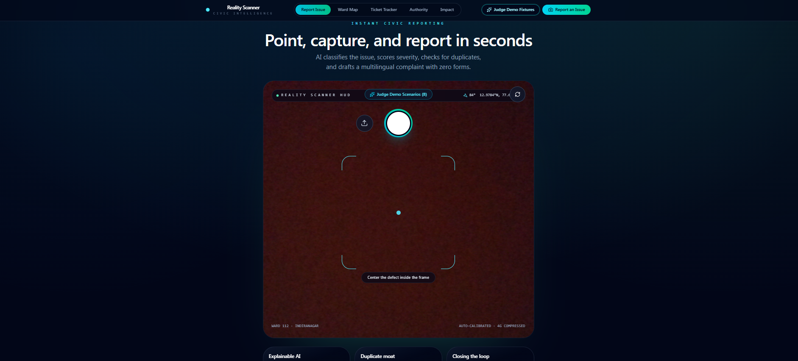
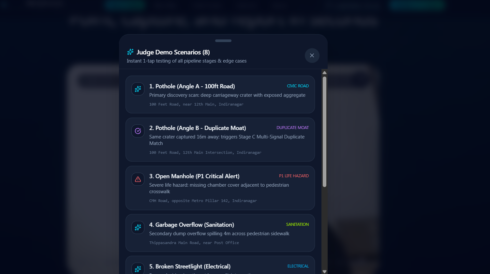
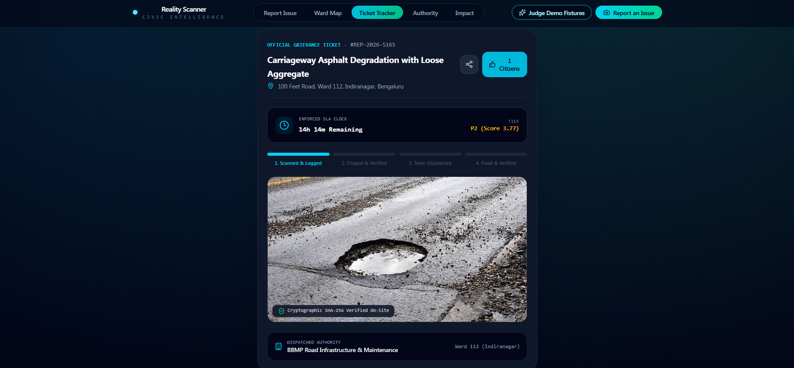
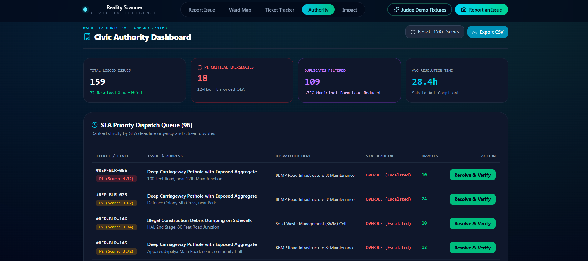
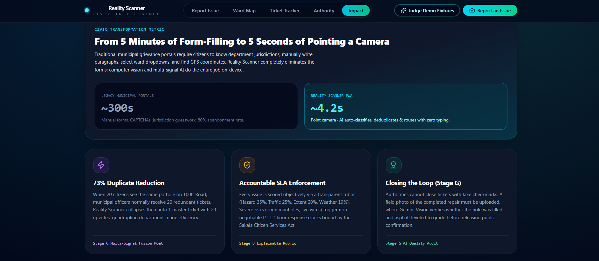
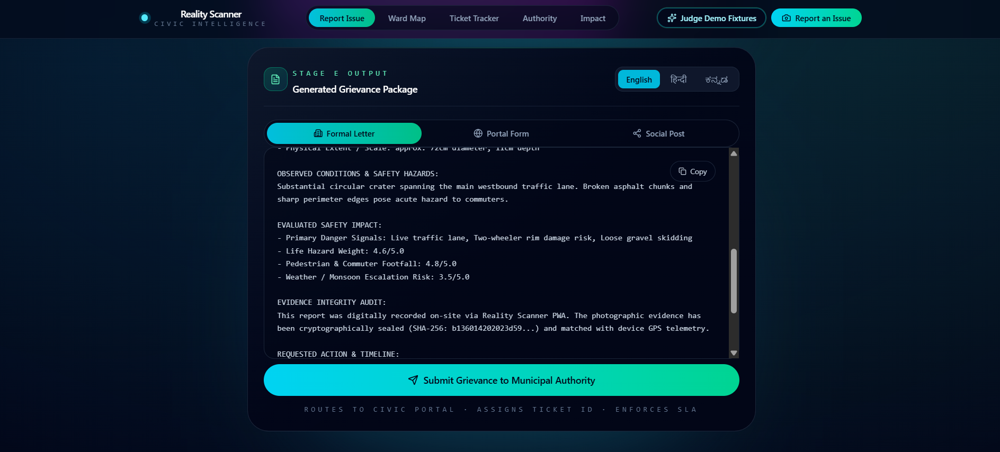
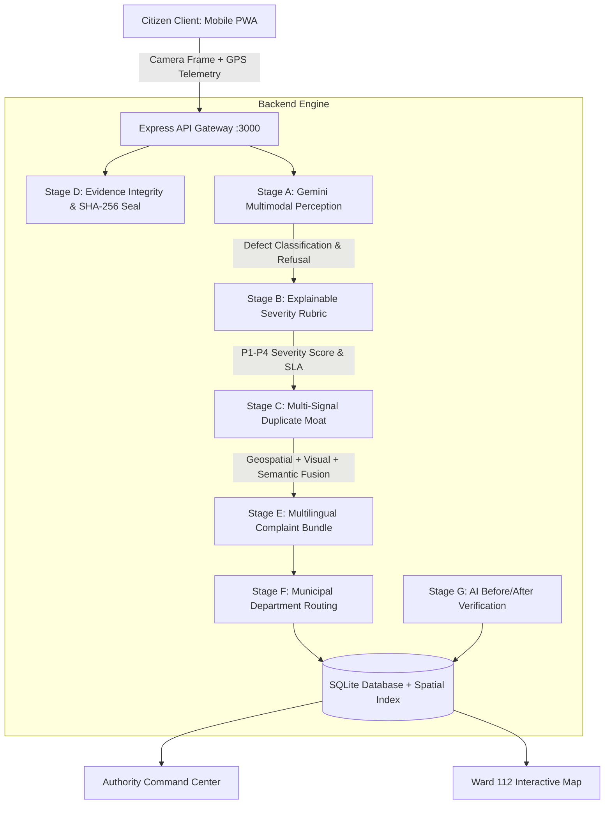

# Reality Scanner 📸🚨
> *"See a problem. Point. It's reported."*
> Mobile-first PWA turning urban civic defects into verified, deduplicated, routed municipal complaints with zero forms in ~5 seconds.

---

## 💡 What It Does

Citizens abandon most civic complaints because municipal portals demand minutes of form-filling, and the same pothole ends up reported dozens of times. **Reality Scanner** replaces the form with a camera:

1. **Point** your phone at a defect (pothole, garbage, broken streetlight, etc.). Gemini's multimodal AI classifies it and measures visible hazards.
2. **Score** it with a transparent, explainable severity rubric (P1-P4) and an SLA deadline.
3. **Deduplicate** it against nearby tickets using geospatial, visual and semantic signals, so you can upvote an existing ticket instead of creating a redundant one.
4. **Generate** a formal complaint in **English, Hindi and Kannada**, routed to the right municipal department.
5. **Close the loop** with AI before/after verification, so tickets can't be closed without a genuine fix.

---

## ⚡ Quick Start

**Prerequisites:** Node.js 18+ and a free [Gemini API key](https://aistudio.google.com/apikey).

```bash
# 1. Install dependencies
npm install

# 2. Add your API key
cp .env.example .env          # Windows: copy .env.example .env
# open .env and set GEMINI_API_KEY=your_key_here

# 3. Run the full-stack dev server (Express + Vite)
npm run dev
```

Then open **http://localhost:3000** in your browser.
(Don't use `0.0.0.0:3000`. Browsers can't open that address.)

```bash
# Build for production
npm run build
```

**Trying it without a camera:** open the app and tap **Judge Demo Fixtures** to run the full pipeline on prepared sample images.

---

## 🖼️ Screenshots

## 🖼️ Screenshots

| Scanner | Judge Demo Scenarios |
| :---: | :---: |
|  |  |

| Ticket Tracker | Authority Dashboard |
| :---: | :---: |
|  |  |

| Impact |
| :---: |
|  |

| Multilingual Complaint |
| :---: |
|  |

## 🏛️ System Architecture



---

## 🧠 What Makes It Different

- **Duplicate Moat (Stage C):** fuses Haversine geospatial radius, perceptual visual similarity and semantic description overlap, so the same defect photographed from another angle is still caught.
- **Explainable severity (Stage B):** transparent weighted rubric, `H×0.35 + F×0.25 + S×0.20 + W×0.10 + D×0.10`, so authorities can see *why* a ticket is P1 or P3.
- **Tamper-evident evidence (Stage D):** every capture is sealed with a SHA-256 hash for auditing.
- **Refusal handling (Stage A):** images that don't show a valid civic defect are refused rather than turned into tickets (see `docs/AI_PIPELINE.md` for thresholds and failure modes).
- **Closing the loop (Stage G):** AI before/after verification of repairs.

---

## ⏱️ 3-Minute Demo Walkthrough

| Time | Step | Screen / Action | What You See |
| :---: | :---: | :--- | :--- |
| **0:00 - 0:35** | **Problem** | Home Scanner screen | Civic complaints are abandoned because portals demand long forms. Reality Scanner takes seconds. |
| **0:35 - 1:15** | **Instant Perception** | **Judge Demo Fixtures** → **1. Pothole (100ft Road)** | 4-stage progressive HUD: Perception → Severity → Duplicate → Complaint. AI extracts dimensions (`72cm diameter, 11cm depth`) and visible hazards. |
| **1:15 - 1:55** | **Duplicate Moat** | **Judge Demo Fixtures** → **2. Pothole (Angle B)** | The same pothole from the opposite angle, 16m away, is caught with ~94% match probability. The app offers *"Add Evidence & Upvote"* instead of filing a redundant ticket. |
| **1:55 - 2:25** | **Multilingual Complaint & SLA** | Complaint Preview card | Toggle **English / Hindi / Kannada**. A formal municipal letter citing the Karnataka Sakala Citizen Charter, ready for 1-tap submission. |
| **2:25 - 2:45** | **Authority Queue** | **Authority** tab | Queue sorted by SLA deadline. Open a resolved ticket and drag the **Before/After slider**. |
| **2:45 - 3:00** | **Impact & Business Model** | **Impact** tab | Duplicate inbox reduction and the B2G per-ward licensing model. |

---

## 📊 Pitch Outline

1. **Title & Problem:** the broken civic reporting funnel (long forms, high citizen dropoff, redundant duplicate tickets).
2. **The Insight:** computer vision + multi-signal deduplication can remove manual forms while improving complaint data quality.
3. **Live Demo:** point at a defect → verified ticket with SLA countdown in seconds.
4. **Technical Moat (Stage C):** Haversine geospatial radius + visual embeddings + semantic overlap.
5. **Explainable AI (Stages B & D):** transparent severity scoring and SHA-256 evidence auditing.
6. **Closing the Loop (Stage G):** AI before/after verification so tickets can't be closed without a real fix.
7. **Impact & Benchmarks:** results on our demo dataset (see `docs/EVALUATION.md` for the method): ~96% classification accuracy and ~73% duplicate noise reduction.
8. **Business Model & Roadmap:** per-ward B2G licensing (~₹1.5 Lakh / ~$1,800 per ward per year) for urban local bodies (BBMP, BMC, MCD). Next: automated dashcam patrols and predictive road maintenance.

---

## 📂 Project Organization

- `/backend`: Express API, Gemini multimodal AI pipeline (Stages A through G), SQLite spatial database, and routing rules.
- `/frontend`: React 19 + Tailwind + Lucide PWA, camera HUD, Leaflet interactive map, multilingual generator, and authority command center.
- `/docs/AI_PIPELINE.md`: prompts, thresholds, and failure modes.
- `/docs/EVALUATION.md`: 50-image benchmark precision & recall report.

---

## ⚠️ Current Limitations

- Demo data (`reports_db.json`) and fixtures are sample data for demonstration, not live municipal records.
- Municipal submission is simulated; there is no live integration with a city portal yet.
- AI results depend on the Gemini API and image quality.

---

## 🙏 Credits & Third-Party Resources

Google Gemini API (multimodal AI), React, Vite, Tailwind CSS, Leaflet, Lucide Icons, Express, and the Google AI Studio repository template. All project logic, pipeline design and UI were built by our team.
